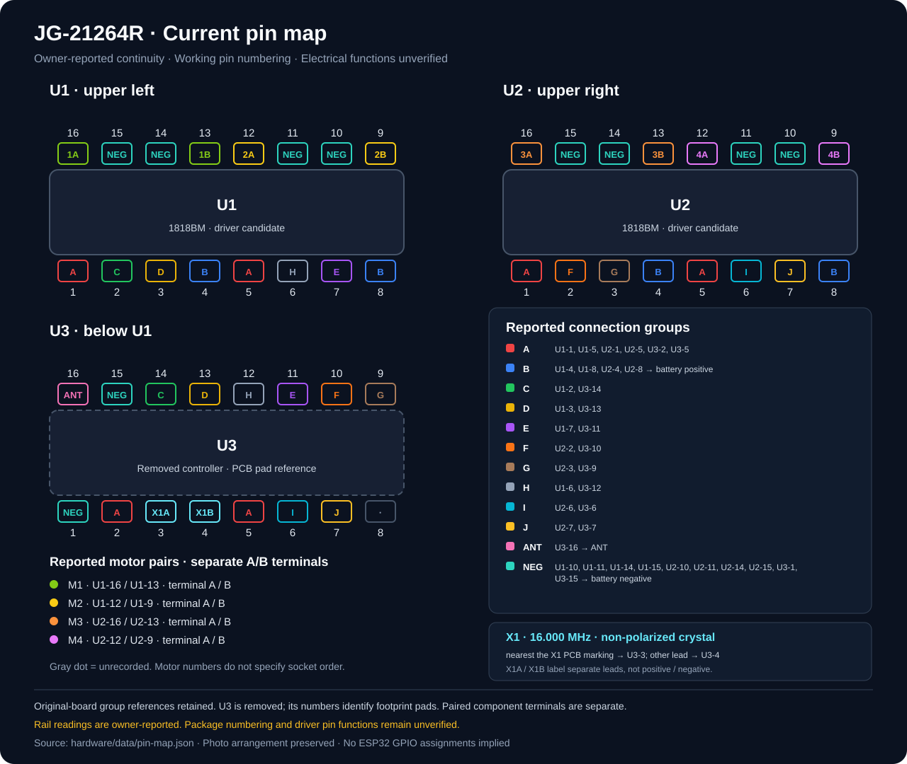
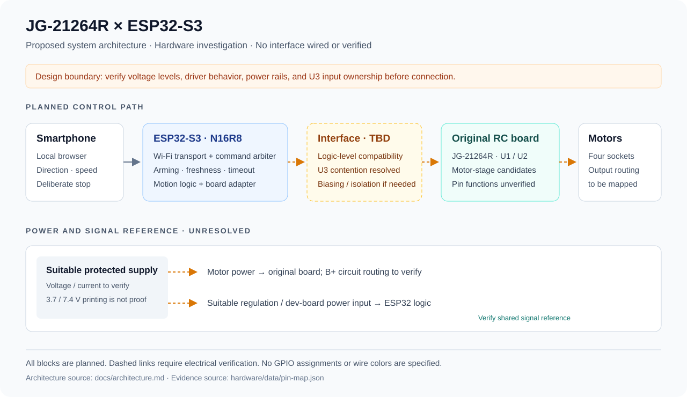
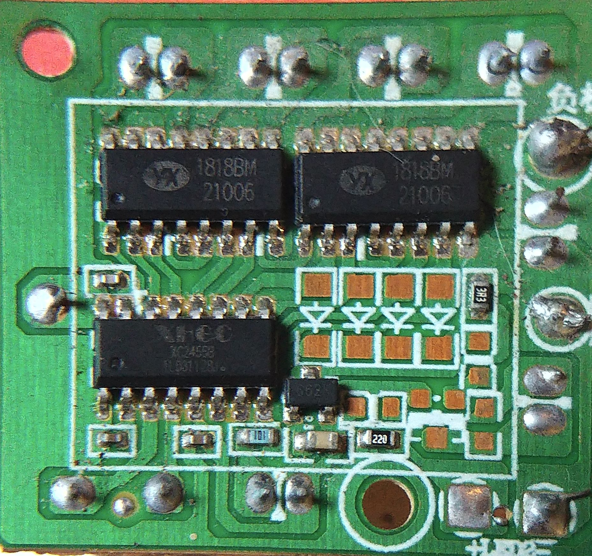
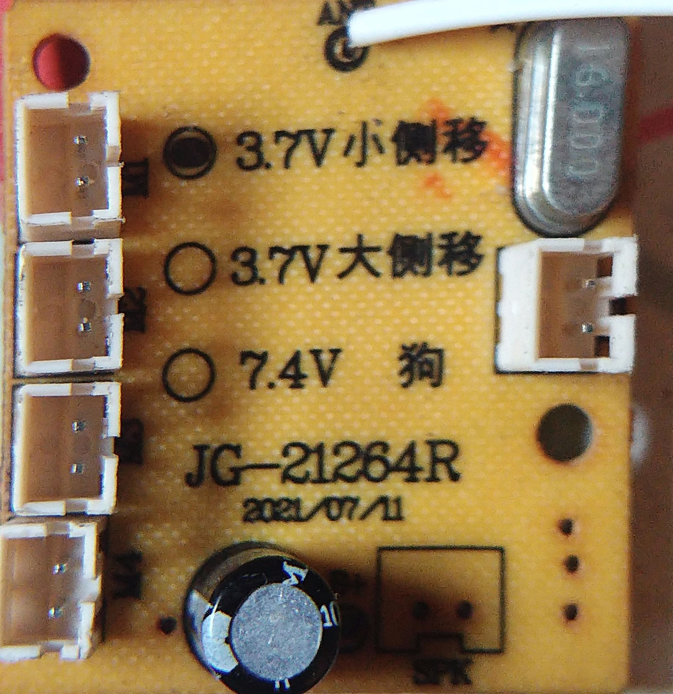

# JG-21264R Reverse Engineering

**Reusing an RC car control board with an ESP32-S3.**

This project documents the reverse engineering of a salvaged **JG-21264R** RC car PCB. The goal is to retain its existing motor-driving circuitry and replace the lost remote-control interface with an **ESP32-S3 N16R8** and smartphone controls.

**Status: hardware investigation.** The photographs and continuity map are recorded; the driver pinout, supply requirements, motor outputs, and safe ESP32 interface remain unverified. No working conversion or firmware is claimed.



## Start here

| Document | Purpose |
| --- | --- |
| [Board identification and photos](docs/hardware.md) | Components, connectors, and remaining uncertainties |
| [Current pin map](docs/pin-map.md) | Colored monospace layout, ASCII fallback, and continuity groups |
| [Measurement history](docs/measurement-log.md) | Owner observations and corrected pin references |
| [System architecture](docs/architecture.md) | Existing board evidence and proposed control/power boundaries |
| [Verification plan](docs/verification-plan.md) | Checks required before powering or connecting the ESP32 |
| [References](docs/references.md) | Source provenance and limits of component identification |
| [Project log](PROJECT_LOG.md) | Current checkpoint and verification evidence |

## Intended behavior

- Smartphone control over a local Wi-Fi connection.
- Forward, reverse, stop, and turning, subject to the verified motor wiring.
- PWM speed control after the existing driver's input behavior is established.
- A configurable stop-on-disconnect behavior and safe startup state.
- Reuse of the original board where measurements establish that it is suitable.

Bluetooth LE is an optional future interface. The ESP32-S3 supports Bluetooth LE; a Bluetooth Classic serial controller is not assumed. See the [official platform reference](docs/references.md#esp32-s3).

## Proposed architecture



The original controller must not contend with the ESP32 for the same driver inputs. The final design must establish control ownership, compatible signal levels, an appropriate logic supply, and a common signal reference where required. No GPIO assignment or board modification is specified yet.

## Board photographs

Original files are preserved without alteration. “Component side” refers to the side with the three visible ICs; the other side also has components.

| Component side | Connector side |
| --- | --- |
|  |  |

## Repository layout

```text
.
├── README.md
├── PROJECT_LOG.md
├── assets/
│   ├── diagrams/              # Generated pin diagram and architecture drawing
│   └── images/                # Original board photographs and provenance
├── docs/                     # Hardware evidence, architecture, and verification
├── firmware/                 # Implementation entry criteria; no firmware yet
├── hardware/
│   └── data/pin-map.json      # Canonical reported connectivity
└── tools/render_pin_map.py    # Standard-library diagram/document generator
```

## Maintaining the pin map

Update `hardware/data/pin-map.json`, append the measurement/correction to `docs/measurement-log.md`, then regenerate the views:

```bash
python3 tools/render_pin_map.py
python3 tools/render_pin_map.py --check
```

`--check` validates pin ranges and group membership, and checks that generated documents match the data. It checks documentation consistency, not electrical continuity. No hardware is accessed.

## Electrical constraints

Keep the ESP32 disconnected during identification. Use continuity/resistance mode only on an unpowered board. A temporary beep is not evidence of a direct copper connection. The printed **3.7 V / 7.4 V** options do not establish the operating voltage of this board configuration, and reported terminal connections do not establish the operating voltage or verified IC supply-pin functions.
