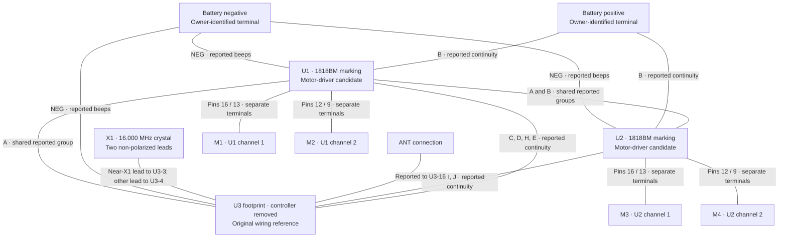
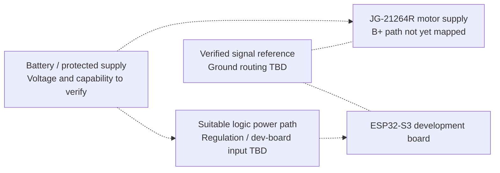

# System architecture

**Architecture status:** proposed integration, dated 2026-11-02. This is a design boundary document, not a wiring schematic or a completed circuit.

## Objective and scope

Use the original JG-21264R board as the motor-power stage, with an ESP32-S3 providing local smartphone control. Preserve the existing board while determining whether its driver inputs can be accessed and safely controlled. The first deliverable is a measured interface specification; firmware follows that specification.

## Original wiring and current rework state

U3 is now removed according to the owner. This graph preserves the original wiring reference; U3 labels now denote its PCB footprint pads. The owner reports the 3.3 V rail remains present, but the agent has not inspected a post-removal image or repeated those measurements. See the [bench record](bench-record.md).

## Existing board: evidence model



Undirected lines summarize owner-reported connections; they do not imply signal direction or verified direct copper. Each motor edge labels two distinct output terminals, not a short between those pins. M3/M4 are project aliases for the U2 channels; physical socket order remains open. Group names correspond to the [canonical map](../hardware/data/pin-map.json).

## Target control path


All blocks in the target path are planned. Dashed links cross hardware boundaries that must be validated before connection.

## Responsibilities and contracts

| Boundary | Responsibility | Required evidence / acceptance condition |
| --- | --- | --- |
| Phone → transport | Deliver deliberate local commands and a stop action | Single active controller; reject malformed/out-of-range commands |
| Transport → command arbiter | Provide commands plus freshness/ownership information | Stale packets and abandoned sessions cannot keep motion enabled |
| Arbiter → motion controller | Admit commands only while deliberately armed | Startup, disconnect, timeout, and fault request the verified stop state |
| Motion → board adapter | Request individual motor direction and bounded speed | Physical motor/socket assignments established before steering or tank mixing |
| Board adapter → interface | Translate abstract states to measured input combinations | Driver truth table, PWM capability, input levels, and transition behavior verified |
| Interface → existing driver stage | Deliver valid signals with one electrical driver per control input | U3 removal reported; verify pad integrity, input compatibility, and biasing |
| Supply → board and ESP32 | Provide appropriate motor and regulated logic power | Fitted board voltage, motor load, dev-board power input, and reference ground verified |

“Stop” must be verified per channel. For M1, the owner observed motion in both directions and stopping after each pulse returned the requested inputs LOW. Coast versus brake, reset behavior, and other channels remain unverified. The first channel has observations for the two single-HIGH commands and both-LOW; both-HIGH remains untested and is not commanded by the bench program. No dead-time, PWM frequency, or current rating has been selected. GPIO4/5 drive the measured M1 bench interface; the final full-vehicle GPIO map remains open.

## Power architecture



Battery-positive identification is separate from logic-supply identification. Motor current must not pass through ESP32 GPIO or an unsuitable logic rail. The final schematic must show any common ground, power switching, decoupling, and back-power prevention required by the measured interface. USB and battery power must not be combined without checking the actual dev-board circuit.

## Control ownership

U3 removal is owner-reported and recorded in the bench log. The owner has rechecked all eight mapped control paths with steady continuity; the two-input passive network at U3 pads 14/13 also matched its 10/11/20 kΩ resistance checks. These checks do not establish input electrical compatibility or certify every adjacent pad. Never parallel driven controller outputs. The eight U1/U2-to-U3 pairs are **candidate control paths**, not proven input pins.

## First-pair bench interface checkpoint

The owner assembled two 1 kΩ series resistors and two 10 kΩ pulldowns at empty U3 pads 14/13. The proposed signal assignments are GPIO4→1 kΩ→pad 14 (U1-2) and GPIO5→1 kΩ→pad 13 (U1-3), with each 10 kΩ pulldown on the driver-side node to B− and ESP32 GND proposed to B−. The owner confirmed the three ESP32 wires connected and the no-motor-load input experiment measured approximately 2.94 V command pulses returning to 0 V, with 3.3 V at U1-1. For the first U1-16/13 output pair, the owner then reported +3.89 V on command `1`, −3.89 V on `2`, and 0 V on `0` with no motors attached. The [bench record](bench-record.md) contains the assembly diagram and matched passive measurements.

This is a provisional experiment, not a validated motor-control interface. USB, battery, and motors stay disconnected during assembly. The separately guided first-pair input experiment reused the flashed GPIO waveform with USB applied first, then the single RC cell; measured input behavior is in the bench record. The first output pair changes polarity electrically; reset transients, loaded behavior, and coast-versus-brake behavior still need verification. The owner subsequently attached one original M1 motor and reported opposite-direction jogs and stopping after both pulses; rated load and other channels remain untested. The planned power architecture above is a future design; standalone tests used USB for the ESP32 and separate single-cell RC-board measurements.

## Permanent interface-board plan

The owner now prefers a separate wired board to clean up the temporary connections. The [interface-board plan](interface-board.md) uses only U3 pads 14/13, 12/11, 10/9, and 6/7 as eight distinct signal wires, plus ground from B−. Each lane has 1 kΩ in series from an ESP32 GPIO and 10 kΩ from the driver-side node to ground. Supply/crystal/antenna/LED-related U3 pads are not connected by this motor-only interface.

The full arrangement needs eight resistors of each value and two labeled nine-position harness connections. Existing four resistors can populate M1 first while the remaining lanes stay open. Other ESP32 GPIOs are unassigned, M2–M4 function testing remains pending, and the current firmware still operates only GPIO4/5. This is a construction plan, not a fabricated or fully tested board. The disassembled chassis does not yet supply wheel/side mapping.

## Planned firmware structure

```text
transport/       Wi-Fi session and command transport; optional later BLE adapter
control/         Command validation, ownership, arming, and timeout
motion/          Motor-state requests and measured chassis mapping
board/           JG-21264R input truth table and hardware configuration
platform/        GPIO, PWM, timers, and board startup handling
```

These are module boundaries for a future implementation; the standalone bench program does not implement the future motion-control stack. ESP-IDF is selected. The project under `firmware/gpio_bench` provides the previously measured ten-second meter mode plus an opt-in manually armed 500 ms M1 test. The latter is locally built/host-tested, flashed by the owner, and has produced bidirectional M1 motion with automatic stopping in the owner-reported first experiment. Its pure-C state machine is separate from GPIO/RTOS handling; console logging cannot block the output task in motor mode. Full vehicle-control firmware remains unimplemented. A future board configuration must reject incomplete pin assignments and must not ship with guessed defaults.

## Decisions and open questions

| Topic | Current decision / open question |
| --- | --- |
| Reuse | Prefer retaining the original power stage; feasibility is still being investigated |
| Wireless | Local Wi-Fi browser control first; Bluetooth LE optional later |
| Driver identity | No verified 1818BM manufacturer pinout obtained |
| Controller identity | XC24558 versus XC2455B marking unresolved |
| Supply | Owner reports a 3.88 V single cell and approximately 3.3 V logic rail; full supply routing and behavior under load remain unverified |
| Motor allocation | Four output pairs recorded; M1 top-left socket and first bidirectional jog/stop observed by owner. Other sockets, chassis sides, and turning method remain open |
| PWM | Required capability to test; no supported range assumed |
| GPIO interface | Eight control paths and first-pair passive network rechecked by owner; ESP32 wiring and approximately 2.94 V input pulses owner-confirmed; first output pair measured +3.89/−3.89/0 V; reset behavior, threshold limits, loaded behavior, and stop mode remain unverified |
| Validation | Unpowered tracing first, then bounded power/logic checks, then unloaded motor tests |

The [verification plan](verification-plan.md) defines what closes each uncertainty.
