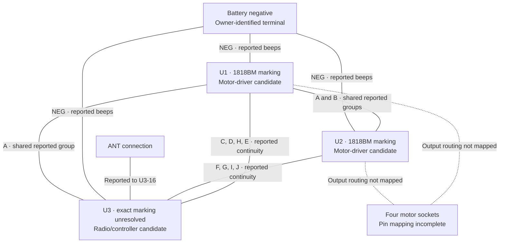
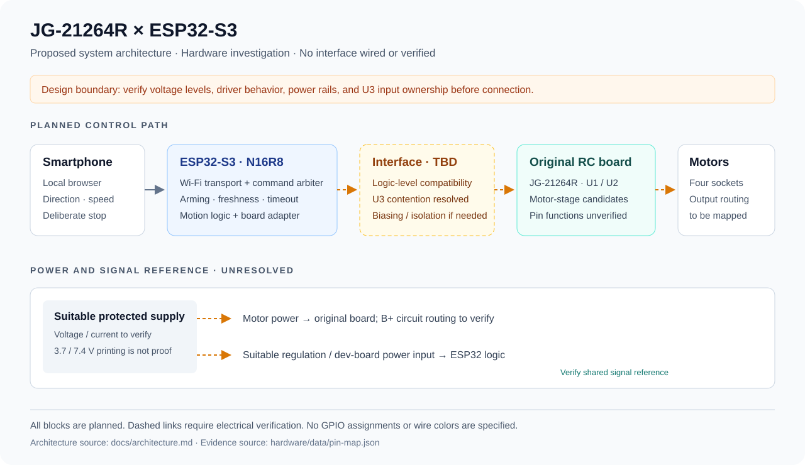
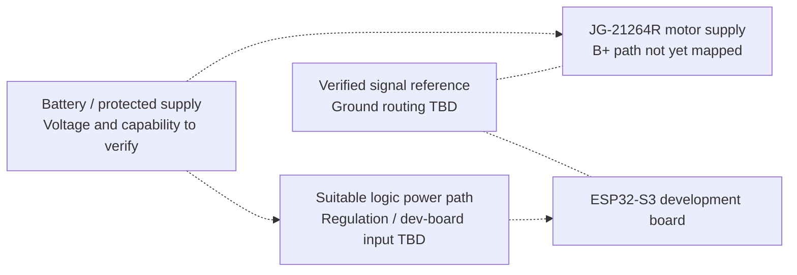

# System architecture

**Architecture status:** proposed integration, dated 2026-11-01. This is a design boundary document, not a wiring schematic or a completed circuit.

## Objective and scope

Use the original JG-21264R board as the motor-power stage, with an ESP32-S3 providing local smartphone control. Preserve the existing board while determining whether its driver inputs can be accessed and safely controlled. The first deliverable is a measured interface specification; firmware follows that specification.

## Existing board: evidence model



Solid undirected lines summarize owner-reported continuity; they do not imply signal direction or verified direct copper. Dotted lines are open mapping tasks. Group names correspond to the [canonical map](../hardware/data/pin-map.json).

## Target control path

```mermaid
flowchart LR
    PHONE["Smartphone\nLocal browser controls"]
    NET["ESP32-S3\nWi-Fi command transport"]
    GUARD["Command arbiter\nValidation · arming · timeout"]
    MOTION["Motion controller\nDesired motor states"]
    HAL["Board-specific adapter\nVerified truth table and PWM"]
    IFACE["Electrical interface · TBD\nVoltage compatibility + input ownership"]
    DRV["JG-21264R power stage\nU1/U2 suitability unverified"]
    MOT["Existing motors"]
    PHONE --> NET --> GUARD --> MOTION --> HAL
    HAL -.-> IFACE -.-> DRV -.-> MOT
```





All blocks in the target path are planned. Dashed links cross hardware boundaries that must be validated before connection.

## Responsibilities and contracts

| Boundary | Responsibility | Required evidence / acceptance condition |
| --- | --- | --- |
| Phone → transport | Deliver deliberate local commands and a stop action | Single active controller; reject malformed/out-of-range commands |
| Transport → command arbiter | Provide commands plus freshness/ownership information | Stale packets and abandoned sessions cannot keep motion enabled |
| Arbiter → motion controller | Admit commands only while deliberately armed | Startup, disconnect, timeout, and fault request the verified stop state |
| Motion → board adapter | Request individual motor direction and bounded speed | Physical motor/socket assignments established before steering or tank mixing |
| Board adapter → interface | Translate abstract states to measured input combinations | Driver truth table, PWM capability, input levels, and transition behavior verified |
| Interface → existing driver stage | Deliver valid signals with one electrical driver per control input | Resolve U3 contention; verify whether level conversion, biasing, or isolation is needed |
| Supply → board and ESP32 | Provide appropriate motor and regulated logic power | Fitted board voltage, motor load, dev-board power input, and reference ground verified |

“Stop” is a required behavior, not an assumed all-low pattern. Whether the driver coasts, brakes, or needs an enable signal is currently unknown. No dead-time, PWM frequency, current rating, GPIO number, or truth-table value has been selected.

## Power architecture



Battery-positive identification is separate from logic-supply identification. Motor current must not pass through ESP32 GPIO or an unsuitable logic rail. The final schematic must show any common ground, power switching, decoupling, and back-power prevention required by the measured interface. USB and battery power must not be combined without checking the actual dev-board circuit.

## Control ownership

Do not parallel ESP32 outputs with U3 outputs. Preferred investigation is non-destructive tracing and measurement before choosing an isolation method. Trace cuts, lifted leads, chip removal, or disabling U3 require an understood circuit and a documented change; none is currently prescribed. The eight U1/U2-to-U3 pairs are **candidate control paths**, not proven input pins.

## Planned firmware structure

```text
transport/       Wi-Fi session and command transport; optional later BLE adapter
control/         Command validation, ownership, arming, and timeout
motion/          Motor-state requests and measured chassis mapping
board/           JG-21264R input truth table and hardware configuration
platform/        GPIO, PWM, timers, and board startup handling
```

These are module boundaries for a future implementation; no source tree is scaffolded to imply it already exists. The exact framework remains open between Arduino and ESP-IDF. A future board configuration must reject incomplete pin assignments and must not ship with guessed defaults.

## Decisions and open questions

| Topic | Current decision / open question |
| --- | --- |
| Reuse | Prefer retaining the original power stage; feasibility is still being investigated |
| Wireless | Local Wi-Fi browser control first; Bluetooth LE optional later |
| Driver identity | No verified 1818BM manufacturer pinout obtained |
| Controller identity | XC24558 versus XC2455B marking unresolved |
| Supply | Battery polarity identified; fitted voltage, B+ routing, and logic rail not verified |
| Motor allocation | Four sockets identified; no electrical output map or chassis-side map yet |
| PWM | Required capability to test; no supported range assumed |
| GPIO interface | Direction, input thresholds, biasing, and U3 isolation unresolved |
| Validation | Unpowered tracing first, then bounded power/logic checks, then unloaded motor tests |

The [verification plan](verification-plan.md) defines what closes each uncertainty.
