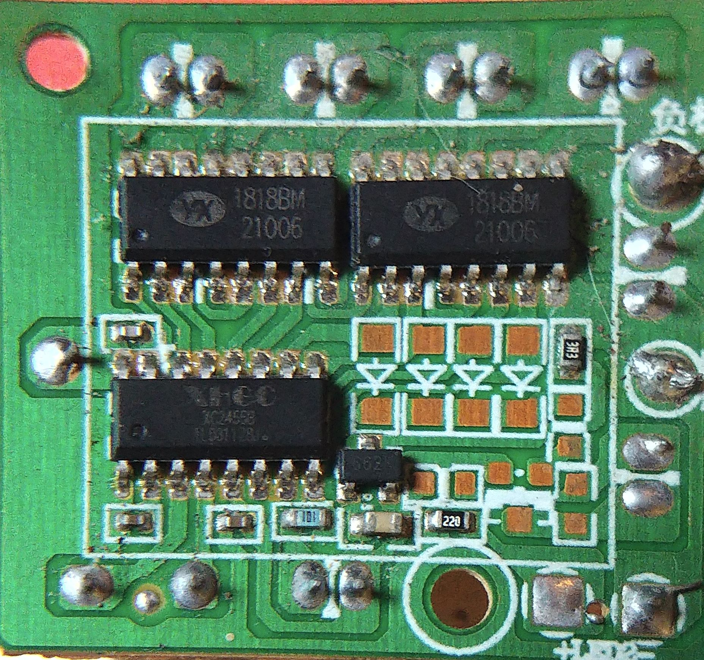
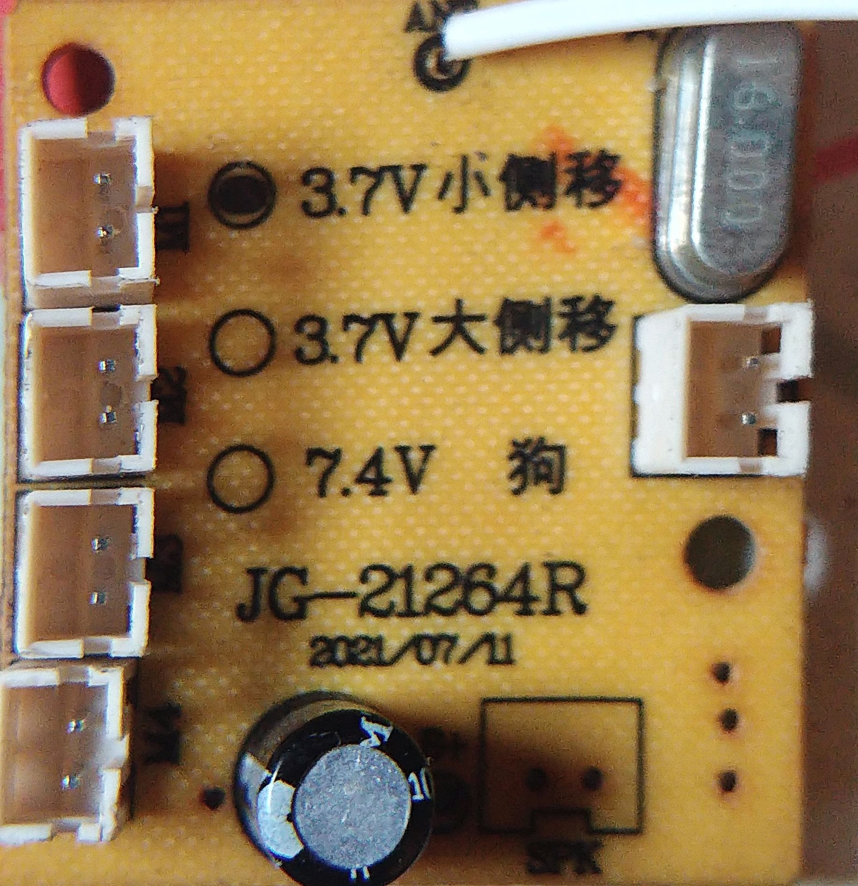

# Board identification

## Photographs and orientation

The drawing and map use this photo's arrangement: **U1 upper left, U2 upper right, U3 below U1**. These U-labels are project aliases, not verified factory reference designators.

The connector-side photo is a separate view. It must be mirrored/aligned before comparing positions across the two sides. Do not transfer a left/right position directly between photographs.

## Current physical state

The owner reports U3 completely removed and the empty footprint clear. Approximately 3.3 V remains at U1-1 relative to B− after removal. No post-removal photo has been reviewed by the agent. The original images and connection groups document the board before rework; U3 numbers now refer to PCB pads. All eight mapped control paths were later reported to give steady continuity. The first-pair resistor network at pads 14/13 is assembled and its passive checks matched; the owner has confirmed the three ESP32 wires connected and measured approximately 2.94 V command pulses returning to 0 V at the two input pads with no motors connected. See the [bench record](bench-record.md).

## Inventory and evidence

| Item | Record | Evidence / remaining uncertainty |
| --- | --- | --- |
| PCB | JG-21264R; printed date 2021/07/21 | Board photograph |
| U1 | Reported YX 1818BM, second line 21006 | Candidate motor driver; manufacturer pinout unverified |
| U2 | Reported YX 1818BM, second line 21006 | Candidate motor driver; manufacturer pinout unverified |
| U3 | Reported XHGC XC24558; XC2455B is a possible reading | Candidate radio/controller; exact marking unresolved |
| Four left sockets | Motor connections | Owner reports four IC output pairs; M1 top-left socket identified by owner; remaining socket order and chassis positions unassigned |
| Right socket | LED | Owner read the LED label; earlier battery-socket guess superseded |
| Bottom two-pin footprint | SPK | Owner read the SPK label; earlier SW interpretation superseded |
| Battery connections | Positive and negative wiring identified by owner, including B+ marking | Exact annotated photo/pad references and B+ circuit tracing still needed |
| ANT | Reported continuity to U3-16 | Does not independently establish U3's full identity or pinout |
| X1 | Silver oval two-lead quartz crystal; case marking 16.000 (16 MHz) | Owner reports near-X1 lead to U3-3 and other lead to U3-4; label is not polarity |
| Unpopulated square pads | Exposed solder pads within component outlines | Exact fitted-component options and circuit functions unverified |
| ESP32-S3 | N16R8 development board | Exact module/dev-board pin availability must be checked before GPIO selection |
| Instruments | Iron, flux, tweezers, and continuity-capable multimeter | Original remote unavailable; two 1 kΩ and two 10 kΩ resistors obtained, measured approximately correct, and assembled for the first-pair interface |
| Software | ESP-IDF and VS Code extension | ESP-IDF 6.0.2 selected and local build passed; owner flashed the GPIO test and measured 3.18 V HIGH returning to 0 V on GPIO4/5 |

The text `21006` is retained as a marking. Its meaning has not been verified; it is not used as an electrical specification.

## Pin numbering

All recorded pin references use the owner's current numbering. The diagrams show positions **16 through 9 across the upper edge** and **1 through 8 across the lower edge**. The drawing records that convention; it does not certify the manufacturer's pin-1 orientation.

Before a pin is used electrically, correlate the physical lead, package indicator, photograph, and a verified package/pinout reference. If a numbering correction is required, explicitly migrate affected records rather than silently rotating the diagram.

## Power status

The board includes printed 3.7 V and 7.4 V configuration options. The owner used one nominal 3.7 V PKCELL cell, measured separately at 3.88 V, and reported approximately 3.3 V at U1-1 before and after U3 removal. Battery protection, motor-load capability, and the full fitted supply circuit remain unverified. Battery polarity identification alone does not authorize applying an arbitrary voltage.

U1-10/11/14/15, U2-10/11/14/15, and U3-1/15 were reported to connect to battery negative. They form the **NEG** candidate group in the map. The original observation was a beep; duration and resistance values were not recorded. Only the listed paths have reported meter evidence; complete rail routing and post-removal group membership remain to be checked.

The blue **Group B** (U1-4/8 and U2-4/8) was subsequently reported to connect to battery positive. The terminal association is recorded; it does not independently establish the operating voltage, a verified IC supply pinout, or the full B+ routing.

## Reported motor outputs

| Motor alias | Chip | Output terminal A | Output terminal B |
| --- | --- | --- | --- |
| M1 | U1 | 16 | 13 |
| M2 | U1 | 12 | 9 |
| M3 | U2 | 16 | 13 |
| M4 | U2 | 12 | 9 |

M1/M2 follow the owner's U1 motor names; M3/M4 distinguish the two U2 channels in this project. Each row describes two separate output terminals across one motor, not a common net. A/B do not specify fixed polarity or rotation direction. The owner identifies M1 at the top-left motor socket in the connector-side photo with JG-21264R upright. One original M1 motor has since moved in both directions and stopped after the armed pulse tests, according to the owner. Other socket positions, rated-load behavior, and chassis mapping remain to be established. For the first U1-16/13 pair only, the owner measured +3.89 V for command `1`, −3.89 V for `2`, and 0 V for `0`, with red on U1-16, black on U1-13, and all motors disconnected. The first reading was explicitly corrected to positive; see the bench record.

## Regulator candidate

The small three-lead device is reported to read `662K`, consistent with an XC6206P332MR-family 3.3 V regulator. The owner measured about 3.3 V at U1-1 both before and after U3 removal. This is not evidence that the small regulator can power an ESP32 Wi-Fi development board; keep standalone ESP32 tests on USB power. Detailed physical lead and resistance readings are in the bench record.

## Crystal X1

The owner read **X1** on the PCB beside the silver oval component and **16.000** on its case. The marking indicates a nominal **16 MHz** quartz crystal. The lead nearest the X1 print connects to **U3-3**; the other lead connects to **U3-4**. These are physical reference labels, not positive/negative polarity. Do not infer that the two IC pins share one copper net or assign oscillator-input/output roles without a verified pinout.

## M1 physical role

The owner reports no separate steering mechanism and assumes M1 drives a wheel. The first M1 motor stayed still before arming, moved on command `1`, and moved oppositely on command `2`, stopping after both pulses. The wheel/axle/side and turning method have not been identified. This is not evidence for a particular tank/skid-steer or conventional-steering model. See the latest bench record.
