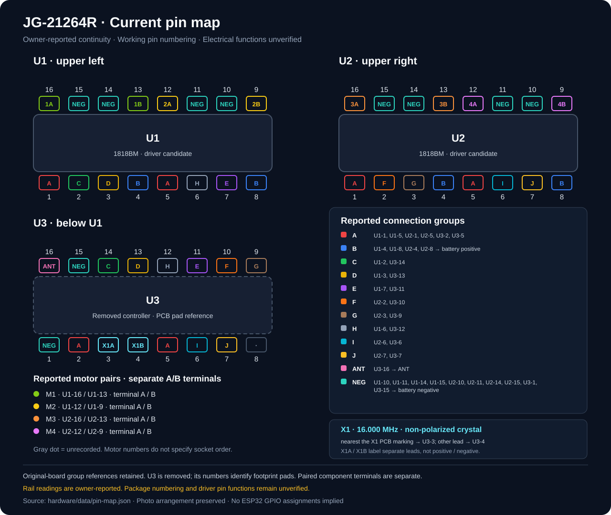

# Current reported pin map

Generated from [pin-map.json](../hardware/data/pin-map.json). Update that file and run `python3 tools/render_pin_map.py`; do not edit this generated document by hand.

**Evidence:** owner-reported continuity, including some beeps whose duration was not recorded. This is not a verified schematic or driver pinout. Group and motor colors organize owner reports; they do not verify pin functions.

## Arrangement matching the component-side photo

U1 is upper left, U2 upper right, and the U3 footprint is below U1. **U3 is removed, according to the owner.** Groups preserve original-board observations; U3 numbers now refer to remaining PCB pads. They do not certify all post-removal connections. Numbering follows the owner's working convention; physical pin-1 orientation remains unverified. The NEG symbol records reported continuity to battery negative, not a certified ground assignment.

```text
                  U1                                             U2
 16🟢 15⏚  14⏚  13🟢 12🟡 11⏚  10⏚  09🟡        16🟠 15⏚  14⏚  13🟠 12🟣 11⏚  10⏚  09🟣
 ┌───────────────────────────────────────┐      ┌───────────────────────────────────────┐
 │                 1818BM                │      │                 1818BM                │
 └───────────────────────────────────────┘      └───────────────────────────────────────┘
 01🟥 02🟩 03🟨 04🟦 05🟥 06⬛ 07🟪 08🟦        01🟥 02🟧 03🟫 04🟦 05🟥 06🔷 07🔶 08🟦


                  U3
 16📡 15⏚  14🟩 13🟨 12⬛ 11🟪 10🟧 09🟫
 ┌───────────────────────────────────────┐
 │              U3 footprint             │
 └───────────────────────────────────────┘
 01⏚  02🟥 03💎 04💎 05🟥 06🔷 07🔶 08⬜
```

**A–J/ANT/NEG symbols identify reported continuity groups. Motor and crystal symbols identify components with two distinct terminals, not a shared electrical net. ⬜ means unrecorded.** Emoji appearance and alignment depend on the viewer's font; use the SVG or ASCII fallback when needed.



## Connection groups

| Symbol | Group | Recorded IC pins | External point | Interpretation |
| --- | --- | --- | --- | --- |
| 🟥 | A | U1-1, U1-5, U2-1, U2-5, U3-2, U3-5 | — | Unidentified shared group |
| 🟦 | B | U1-4, U1-8, U2-4, U2-8 | battery positive | Reported positive-terminal connection; voltage and direct copper unverified |
| 🟩 | C | U1-2, U3-14 | — | Unidentified connection |
| 🟨 | D | U1-3, U3-13 | — | Unidentified connection |
| 🟪 | E | U1-7, U3-11 | — | Unidentified connection |
| 🟧 | F | U2-2, U3-10 | — | Unidentified connection |
| 🟫 | G | U2-3, U3-9 | — | Unidentified connection |
| ⬛ | H | U1-6, U3-12 | — | Unidentified connection; supersedes U1-6 to U3-5 |
| 🔷 | I | U2-6, U3-6 | — | Unidentified connection |
| 🔶 | J | U2-7, U3-7 | — | Unidentified connection |
| 📡 | ANT | U3-16 | ANT | Reported antenna connection |
| ⏚ | NEG | U1-10, U1-11, U1-14, U1-15, U2-10, U2-11, U2-14, U2-15, U3-1, U3-15 | battery negative | Reported negative-terminal beeps; ground/direct copper unverified |

## Reported motor-output pairs

M1/M2 follow the owner's U1 names; M3/M4 are project aliases for the corresponding U2 channels. These names do not identify a physical socket order, chassis side, or rotation direction. A/B are neutral terminal labels, not fixed positive/negative polarity.

**Each motor connects between its A and B output terminals. A motor pair is not recorded as two pins shorted together.**

| Symbol | Motor | IC | Terminal A | Terminal B | Source record |
| --- | --- | --- | --- | --- | --- |
| 🟢 | M1 | U1 | 16 | 13 | M16 |
| 🟡 | M2 | U1 | 12 | 9 | M17 |
| 🟠 | M3 | U2 | 16 | 13 | M18 |
| 🟣 | M4 | U2 | 12 | 9 | M19 |

## Crystal marking and physical lead reference

**X1** is the owner-read PCB marking beside the two-lead crystal; the case reads **16.000**, interpreted as **16 MHz**. The PCB label is not a polarity mark or a manufacturer lead number.

| Physical lead | Recorded IC connection | Map label |
| --- | --- | --- |
| nearest the X1 PCB marking | U3-3 | X1A |
| other lead | U3-4 | X1B |

```text
U3-3 ---[ X1 : 16.000 MHz ]--- U3-4
 near X1 marking                  other lead
```

The crystal is non-polarized. A/B label its observed physical leads only. Its two U3 connections remain distinct; no direct copper connection between them is inferred. Oscillator input/output roles remain unverified.


## ASCII fallback

Each pin is followed by its group ID or motor-terminal ID (`1A`/`1B` through `4A`/`4B`) or crystal-terminal ID (`X1A`/`X1B`); `.` means unrecorded. The file [pin-map.ascii.txt](pin-map.ascii.txt) is plain ASCII.

```text
                     U1                                                             U2
 16:1A  15:NEG 14:NEG 13:1B  12:2A  11:NEG 10:NEG 09:2B         16:3A  15:NEG 14:NEG 13:3B  12:4A  11:NEG 10:NEG 09:4B
 +-------------------------------------------------------+      +-------------------------------------------------------+
 |                         1818BM                        |      |                         1818BM                        |
 +-------------------------------------------------------+      +-------------------------------------------------------+
 01:A   02:C   03:D   04:B   05:A   06:H   07:E   08:B          01:A   02:F   03:G   04:B   05:A   06:I   07:J   08:B


                     U3
 16:ANT 15:NEG 14:C   13:D   12:H   11:E   10:F   09:G
 +-------------------------------------------------------+
 |                      U3 footprint                     |
 +-------------------------------------------------------+
 01:NEG 02:A   03:X1A 04:X1B 05:A   06:I   07:J   08:.
```

## Important corrections

- U1-6 is connected to U3-12 in **H**, replacing the earlier U3-5 entry. It is not part of A.
- A retains U3-2 and U3-5 after the owner's explicit reversion.
- U1-3 uses U3-13, and U1-7 uses U3-11.
- U2-6 to U3-6 is a separate later observation, preserved in I.

See the [measurement history](measurement-log.md) for provenance and the [verification plan](verification-plan.md) before using any group as an electrical interface.
